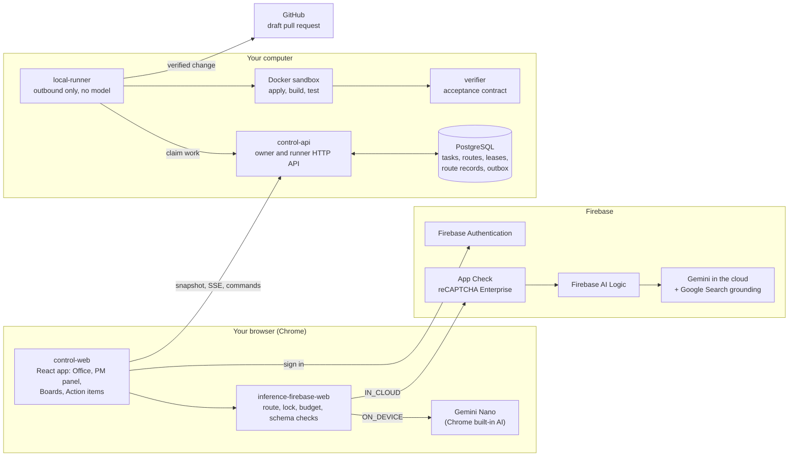
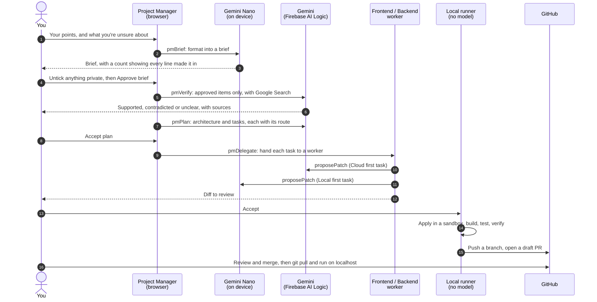
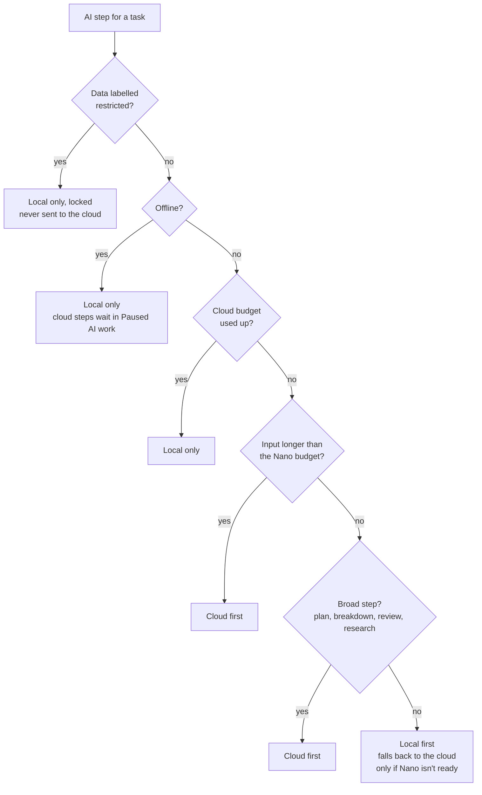

# SelariKru

**A small AI software team in your browser, running on Gemini Nano on your device when it can and on Gemini in the cloud when it needs to, all through Firebase AI Logic.**

You give the Project Manager your rough notes. Gemini Nano turns them into a brief on your own machine. Gemini in the cloud checks the brief against Google Search and drafts the plan. The PM hands each task to a frontend or backend worker. Every change a worker proposes is applied, built and tested by a local runner on your computer, which uses no model, and each verified change arrives as a draft pull request on GitHub.

- **Try it:** <https://selarikru.web.app>. This is a hosted demo on demo data, and its AI calls are real.
- **Run it yourself:** `npx github:0xhaz/SelariKru` (see [Getting started](#getting-started)).
- **Testing guide:** [TESTING.md](TESTING.md)
- **Licence:** [Apache-2.0](LICENSE)

---

## Why it exists

AI coding tools ask you to make one choice for a whole project: send everything to a cloud model, or settle for a small local one. Real projects aren't like that. Some notes are private or under contract, some steps are short and bounded, and some need a large model and fresh facts from the web. Developers in places with patchy connections, or on a free tier, also need the work to keep going when the cloud isn't available.

SelariKru makes that choice **per task and per step**, explains each choice in plain words, and keeps a record of where every AI call actually ran:

- **Restricted work stays on your device.** A task whose data is labelled restricted is locked to *Local only*. Its prompts are never sent to the cloud, and the lock is checked again before every call.
- **Short, bounded steps run locally first.** Formatting a brief or suggesting acceptance criteria runs on Gemini Nano. If Nano isn't ready, the step falls back to the cloud, and the fallback is labelled as one.
- **Broad steps go to the cloud first.** Planning a whole feature, reviewing a change or researching a question with Google Search goes to Gemini in the cloud.
- **Going offline pauses cloud work; it doesn't lose it.** A step that needs the cloud waits in *Paused AI work* and is sent after you reconnect. Local work carries on.
- **A person stays in charge.** Nothing is merged for you. You approve the brief, accept the plan, review each diff, and merge the draft PR yourself.

The audience is a solo developer or a small product team building a real web app, who wants AI help without giving up control of their data, their budget or their main branch.

---

## How Firebase AI Logic is used

Every AI call in the app goes through **Firebase AI Logic's hybrid inference** in the browser (`firebase@13.1.0`, `firebase/ai`). The app calls no other model API.

| What | Where |
|---|---|
| The SDK import: `getAI`, `getGenerativeModel`, `GoogleAIBackend`, `InferenceMode` | [`packages/inference-firebase-web/src/firebase-sdk.ts:8`](packages/inference-firebase-web/src/firebase-sdk.ts#L8) |
| App Check with reCAPTCHA Enterprise, initialised before any call | [`firebase-sdk.ts:28`](packages/inference-firebase-web/src/firebase-sdk.ts#L28) |
| `getAI(app, { backend: new GoogleAIBackend() })` | [`firebase-sdk.ts:37`](packages/inference-firebase-web/src/firebase-sdk.ts#L37) |
| `getGenerativeModel` with the hybrid `mode`, `onDeviceParams` (Gemini Nano, with a JSON response constraint) and `inCloudParams` (Gemini, a JSON schema or the Google Search tool) | [`firebase-sdk.ts:40`](packages/inference-firebase-web/src/firebase-sdk.ts#L40) |
| `model.generateContent(prompt)`, and `inferenceSource`, which records where the answer actually ran | [`firebase-sdk.ts:84`](packages/inference-firebase-web/src/firebase-sdk.ts#L84) |
| The adapter: chooses the mode for each call, enforces locks, budgets and offline rules, validates every answer against its schema, and writes a route record | [`packages/inference-firebase-web/src/adapter.ts`](packages/inference-firebase-web/src/adapter.ts) |
| The agents' roles, prompts and schemas | [`packages/inference-firebase-web/src/agents.ts`](packages/inference-firebase-web/src/agents.ts) |

`firebase-sdk.ts` is the only file that imports the Firebase AI SDK, so everything above it can be tested with a fake SDK.

**Firebase products used:**
- **Firebase AI Logic**, with the Gemini Developer API backend, for hybrid inference: Gemini Nano on device and Gemini in the cloud.
- **App Check**, with reCAPTCHA Enterprise, on every AI Logic call.
- **Firebase Authentication**: the owner signs in to the local stack (using the Auth Emulator in development).
- **Firebase Hosting** serves the hosted demo.

**The AI agents.** Each one is a role prompt plus a JSON schema, and each runs on whichever side its route allows:

| Agent step | What it does | Suggested route |
|---|---|---|
| `pmBrief` | Formats your rough points into a brief, and checks that every line is accounted for | Local only (always on the device) |
| `pmVerify` | Checks the approved brief against Google Search, item by item, with sources | Cloud only, grounded with Google Search |
| `pmPlan` | Drafts the architecture and a task plan from the checked brief | Cloud first |
| `pmResearch` | Answers a question from the web, with sources | Cloud first, grounded with Google Search |
| `pmAnswer` | Answers your questions about the project | Local first |
| `pmDelegate` | Proposes which worker takes each task | Local first |
| `draftBrief`, `suggestCriteria` | Writes task briefs and acceptance criteria | Local first |
| `planTasks`, `breakDownTask` | Plans a run and splits large tasks | Cloud first |
| `proposePatch` | A worker's code change, as a diff | Local first |
| `reviewChange` | Reviews a diff | Cloud first |
| `triageFailure` | Explains a failed build or test | Local first |
| `describePullRequest` | Writes the draft PR's description | Local first |

Bounded steps are suggested as *Local first* and broad ones as *Cloud first*, and a long input or a restricted label changes that (see [How a call's route is chosen](#how-a-calls-route-is-chosen)). You can set any task's route yourself, except on a restricted task.

Model answers are treated as **untrusted proposals**. A proposal is checked against its schema, its scope (the files and requirement IDs it may touch) and its route before you see it, and nothing it says can change grants, paths or approvals.

---

## Architecture



**What runs where:**
- **AI runs only in the browser**, through Firebase AI Logic. The adapter reads the task's route fresh from the server just before each call, so a stale screen can't widen a route.
- **The control API** is a TypeScript HTTP server over PostgreSQL. PostgreSQL is the only source of truth for tasks, claims, leases, budgets and route records. There's no in-memory scheduler.
- **The local runner** pairs with the API once, then only makes outbound connections. It claims an accepted change, applies it in a Docker sandbox, runs the project's build and tests, and has the verifier check them. **It calls no model.** A verified change is pushed to a branch and opened as a draft PR. Nothing in the code can merge.
- **The hosted demo** at selarikru.web.app is the same web app built on demo data: a fixed, simulated project with no server and no sign-in. Its AI calls are real, and cloud calls are capped per tab to protect the free-tier quota.

---

## Workflow



### How a call's route is chosen

Each task has a route: **Local only**, **Local first**, **Cloud first** or **Cloud only**. SelariKru suggests one and gives its reason, and you can change it, except on restricted tasks. The suggestion follows these rules in order ([`packages/domain/src/route-policy.ts`](packages/domain/src/route-policy.ts)):



**At call time, the adapter enforces the route:**
- A *Local only* call is made with `ONLY_ON_DEVICE` and no cloud parameters, so the SDK has nothing to fall back to.
- If Nano is unavailable, *Local only* and restricted steps are **blocked**, and they wait for Nano rather than going to the cloud.
- Every answer's `inferenceSource` is compared with the route. An answer from the wrong side is recorded as a **route violation** and isn't accepted.
- **Boards › AI calls** lists every call: where you asked it to run, where it actually ran, and how long it took.

---

## Features

- **The Office:** a pixel-art shophouse with a desk for each worker and a Project Manager who walks to the plan board and delivers each task. A rooftop shows the **On this device · Gemini Nano** and **Cloud · Gemini** boxes lighting up as calls run.
- **Plan brief:** rough notes become a brief on your device. You approve what's sent, it's checked in the cloud with Google Search, and the plan is drafted from it.
- **Per-task routes,** each with a plain-language reason, and a lock for restricted data.
- **Workers that propose diffs,** for you to review. A local runner applies, builds and tests each one, and the verified change arrives as a draft PR.
- **Offline and budget handling:** paused steps are saved as checkpoints and sent after reconnecting. You can also move a paused step to your device or drop it.
- **Boards › AI calls:** the record of every call.
- **Guided tour and accessibility:** a six-step tour of the hosted demo. The main views pass a WCAG 2.2 AA axe check, and reduced motion is respected.

**Benchmark.** On one machine (Chrome 157 with Gemma 4 as Gemini Nano on device, and `gemini-3.5-flash-lite` in the cloud), 10 synthetic briefs were run 3 times on each route. 30 of 30 attempts passed on each route, with a median complete response of 4.4 s on device and 9.7 s in the cloud. This measures this setup only: it doesn't show that the device is faster in general, and answer quality wasn't scored. The redacted records are in [`apps/control-web/public/benchmark-results.json`](apps/control-web/public/benchmark-results.json).

---

## Getting started

### Hosted demo

Open <https://selarikru.web.app> in desktop Chrome. You don't need an account. To run calls on your device, Chrome needs the built-in Prompt API (Gemini Nano). For Gemma 4 in Chrome 157, also turn on `chrome://flags/#gemma4-for-built-in-ai` and relaunch Chrome. Without Nano, the app says so and runs *Local first* steps in the cloud, labelled as a fallback. [TESTING.md](TESTING.md) has the details.

### Your own computer

You need Node 24, pnpm (`corepack enable`), git, Docker, the Firebase CLI and desktop Chrome, plus your own Firebase project with AI Logic and App Check turned on. Then run one command:

```sh
npx github:0xhaz/SelariKru
```

This does four things:
1. It clones SelariKru into a `SelariKru` folder and runs `pnpm install`.
2. On the first run, it asks you to paste your Firebase web config (the `firebaseConfig` object from the Firebase console) and your App Check site key. It writes them to the two git-ignored env files.
3. It sets up a small local Feedback Board project for the team to build, with GitHub off.
4. It runs `pnpm start`, which pairs the local runner with the stack on first start and opens Chrome at <http://127.0.0.1:5173>.

Sign in with `owner@selarikru.invalid` and password `real-run-local-only-password`. Both exist only in the local Auth Emulator, so they're not secrets. Run the same command again to start SelariKru next time, and press Ctrl+C to stop it.

To do it by hand instead:

```sh
git clone https://github.com/0xhaz/SelariKru.git
cd SelariKru
pnpm install
cp .env.example .env                                            # then fill in the values it lists
cp apps/control-web/.env.example apps/control-web/.env.local    # your own Firebase web config
pnpm start --check                                              # lists anything still missing
pnpm start
```

`pnpm start` checks your machine, then starts PostgreSQL, the Auth Emulator, the control API, the web app and the local runner, and opens Chrome. The env files list the variable names only, and no keys are committed. [TESTING.md](TESTING.md) covers:
- pairing the runner;
- connecting a project to GitHub;
- running each part on its own;
- deploying the hosted demo.

### Tests

```sh
pnpm typecheck
pnpm db:up         # PostgreSQL in Docker, for the persistence and API tests
pnpm test
```

Browser tests (Playwright) are in `apps/control-web/tests/`.

---

## Repository layout

| Path | What it is |
|---|---|
| `apps/control-web` | The React web app: the Office, the PM panel, Boards, Settings and the hosted demo build |
| `apps/control-api` | The owner and runner HTTP API |
| `apps/local-runner` | The paired runner: applies accepted changes in a Docker sandbox, with no model |
| `packages/inference-firebase-web` | **The Firebase AI Logic adapter and the agents** |
| `packages/domain` | Schemas, the task state machine and the route policy |
| `packages/policy` | Deterministic policy and data routing (pure functions) |
| `packages/persistence` | The PostgreSQL schema, migrations and outbox |
| `packages/protocol`, `packages/view-protocol` | API contracts and the UI's permission-filtered view model |
| `packages/data-source-live`, `packages/data-source-mock` | The live API client, and the demo data used by the hosted demo |
| `packages/integrations-github` | Branch push and draft PRs (it can't merge) |
| `packages/runtime-docker-local` | The Docker sandbox runtime and post-run diff checks |
| `services/workflow` | The database scheduler: claims, leases, fencing and budgets |
| `services/verifier` | The independent verifier for the example project's acceptance contract |
| `examples/feedback-board-starter` | A small Express and React app that SelariKru builds features into in the demo |
| `infra/` | The `npx` launcher (`npx.mjs`), `pnpm start` (`start.mjs`) and the dev stack scripts |
| `tools/benchmarks` | The benchmark harness |

`packages/harness-claude` is an optional adapter for running Claude Code as a coding worker. **It is off by default and isn't used in this submission:** with `SELARIKRU_CODING_WORKERS` unset, the runner registers no model worker and only applies changes.

---

## Built during the submission period, and pre-existing work

The submission period began at **1:30 PM PT on 11 Nov 2026**. This repository started on 8 Nov 2026.

- **Before the period** (up to commit `336d976`, 11 Nov 2026 11:17 PT; 243 commits):
  - the domain model and route policy;
  - the control API, PostgreSQL schema, scheduler, local runner, verifier and GitHub draft-PR integration;
  - the first Firebase AI Logic adapter and its agents;
  - the Office UI;
  - AI checkpoints on the server.
- **During the period** (`336d976..HEAD`; 81 commits, about 42,000 lines added, excluding the lockfile):
  - **Offline and paused AI work:** checkpoints in the browser, resume after reconnecting, and recovery from network blips.
  - **The hosted demo:** a demo-data build, App Check, a per-tab cloud call cap, a pre-deploy safety check, and a first-visit tour.
  - **Boards › AI calls**, and an honest state when Gemini Nano is unavailable.
  - **Plan brief:** device formatting (`pmBrief`), a cloud check grounded with Google Search (`pmVerify`), and restricted notes kept off the server.
  - **The Project Manager's errands:** a walking PM that delivers each task, and the new shophouse office floor.
  - **The benchmark:** Gemma 4 on device against Gemini in the cloud.
  - **`npx github:0xhaz/SelariKru` and `pnpm start`,** and the **Run locally** guide on the hosted demo.
  - An accessibility pass, and fixes from review.

**Third-party code:**
- Some files in `apps/control-web` (the pixel-office scene) are adapted from an MIT-licensed project. The licence, the list of adapted files and the attribution are in [THIRD_PARTY_NOTICES.md](THIRD_PARTY_NOTICES.md) and [apps/control-web/THIRD_PARTY_NOTICES.md](apps/control-web/THIRD_PARTY_NOTICES.md). Each adapted file also carries a header saying so.
- The bundled fonts are under the SIL Open Font License.

**Tools used to build it:** SelariKru was written with the help of AI coding assistants (Claude Code). Inside the app, every AI call goes through Firebase AI Logic.

---

## Licence

[Apache License 2.0](LICENSE). Third-party notices are in [THIRD_PARTY_NOTICES.md](THIRD_PARTY_NOTICES.md).
